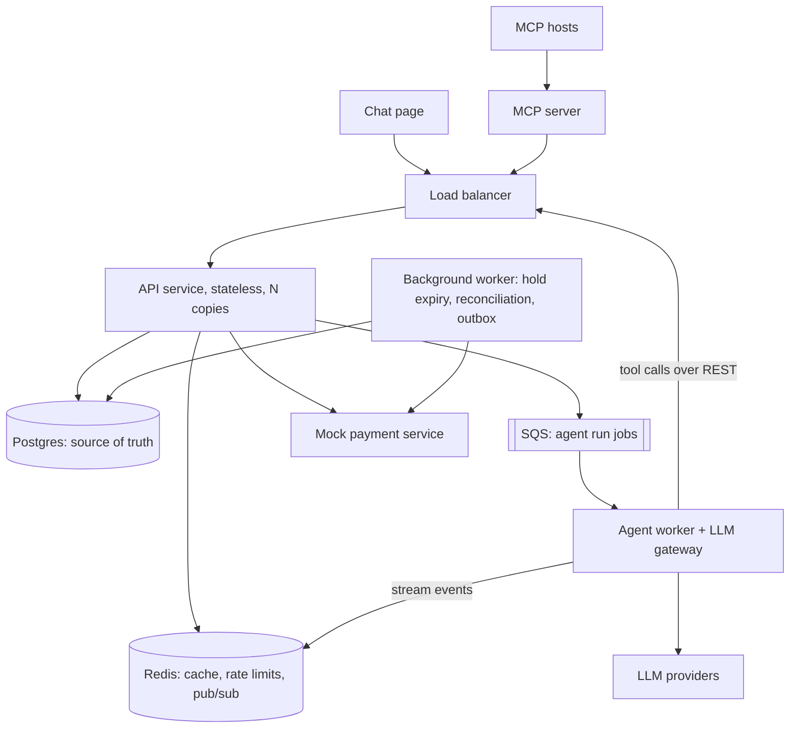

# Rushline: design doc

Status: draft v1 · Author: Chinmai S D · Last updated: 2026-11-04

## Context

Ticket launches for popular shows (and Tatkal-style train bookings) send thousands of users at a few hundred seats in the same minute. Most systems handle the read load badly (slow seat maps) or the write contention badly (double booking, stuck seats, double charges).

Rushline is a seat booking backend built to stay correct and fast under that rush, plus an AI agent that books seats on a user's behalf through the same backend. The agent is just another client, so every backend guarantee applies to it.

## Goals

- No double booking under any level of concurrency.
- Fast seat maps during a spike.
- No lost or double payments, even when the payment provider times out.
- An agent that can search, hold, book and cancel seats safely, with human approval before any payment.
- Fully reproducible AWS deployment with Terraform and keyless CI/CD.

## Non-goals

Real payments, refunds of captured money, signup flows (seeded users + JWT only), reviews, recommendations, dynamic pricing, multi-region, a polished frontend (one simple chat page).

## Requirements

### Functional

1. A user can browse shows and see a live seat map.
2. A user can hold up to 6 seats for 10 minutes.
3. A user can pay for a hold and get a booking.
4. A user can cancel a booking.
5. A user can chat with an agent that answers venue policy questions with citations and does 1 to 4 through tools. The agent may create holds on its own but must get explicit user approval before payment.

### Non-functional

| Requirement | Target |
|---|---|
| Double bookings | 0, always |
| Seat map latency | p99 < 200 ms |
| Hold and booking latency | p99 < 1 s during a spike |
| Confirmed bookings | never lost |
| Agent first token | < 2 s |
| Agent cost | hard token budget per conversation |
| Agent safety | never pays without approval, never touches another user's booking |
| Cloud cost | < $30/month, torn down when idle |

### Rough numbers (design scale)

| | Calculation | Result |
|---|---|---|
| Seat map reads | 1M users × 20 views/day | ~230 RPS avg, ~10k RPS at launch spike |
| Bookings | 200k/day | ~2/s avg, a few hundred/s at spike, on the same few hundred seats |
| Storage | 200k bookings × ~500 B | ~36 GB/year |
| Agent LLM calls | 5% of users × ~8 calls | ~400k/day, ~50 RPS peak |
| Agent tokens | 400k calls × ~3k tokens | ~1.2B tokens/day |

What the numbers decide:
- Reads are huge and repetitive → cache seat maps in Redis.
- Writes are small in volume but contend on the same rows → a correctness problem, solved with Postgres locking. No Kafka.
- 36 GB/year fits one Postgres instance → no sharding.
- LLM calls take seconds → run agent turns on background workers and stream results.
- Token volume dominates cost → an LLM gateway with model routing, fallback and per-user budgets.

Load tests will run at whatever scale the AWS budget allows. Reported numbers will always be measured, never extrapolated.

## Design

### Architecture



Why each box exists:

| Box | Justification |
|---|---|
| Postgres | Bookings need transactions and row-level locking. Also holds policy chunks with pgvector, so RAG needs no extra database. |
| Redis | Seat-map reads are thousands of times more frequent than writes and must return in < 200 ms. Also rate limits and pub/sub for streaming. |
| Load balancer + N API copies | The API keeps no state in memory, so copies can be added during a spike and one crash doesn't take the system down. |
| SQS + agent worker | Agent turns take 10 to 30 s and must not tie up web workers. SQS gives retries and a dead-letter queue. |
| Background worker | Frees expired holds, reconciles unknown payment states, and publishes outbox events, without slowing user requests. |
| Mock payment | Lets us inject latency, failures and timeouts on demand to prove the payment flow is safe. |
| MCP server | Exposes booking tools to any MCP host. A thin wrapper over the REST API, so every rule still applies. |

Rules:
- The agent and MCP server call the REST API, never the database. Business rules live in the backend, never in prompts.
- The LLM gateway is a module inside the worker, not a separate service, until a second consumer needs it.

### API

```
Auth: JWT bearer token (seeded demo users)

GET    /shows?cursor=&limit=                    cursor pagination
GET    /shows/{id}/seats                        cached ~1 s

POST   /holds      {show_id, seat_ids}          Idempotency-Key required
       201 {hold_id, expires_at} | 409 seat unavailable | 422 too many seats | 429 limit
DELETE /holds/{id}                              204

POST   /bookings   {hold_id, payment_token}     Idempotency-Key required
       201 {booking_id} | 410 hold expired | 402 payment failed
DELETE /bookings/{id}                           204 (soft cancel)

POST   /conversations                           201 {conversation_id}
POST   /conversations/{id}/messages {text}      202 {run_id}
GET    /runs/{id}/stream                        SSE
POST   /runs/{id}/approvals/{aid} {decision}    resumes the run
```

GETs and DELETEs are safe to retry by nature. POSTs are safe to retry only because of the Idempotency-Key.

### Data model

```
users, venues, shows
seats            id, show_id, seat_no, price_paise, status, hold_id, version
                 UNIQUE (show_id, seat_no), INDEX (show_id, status)
holds            id, user_id, show_id, status, expires_at, payment_deadline
                 partial INDEX (expires_at) WHERE status IN ('active', 'paying')
bookings         id, user_id, hold_id UNIQUE, amount_paise, status, payment_ref
idempotency_keys (user_id, key) PK, request_hash, response_status, response_body
outbox           id, event_type, payload, created_at, published_at

conversations    id, user_id, created_at
agent_runs       id, conversation_id, status, tokens_in, tokens_out, cost_usd
approvals        id, run_id, action, status, expires_at
policy_chunks    id, venue_id, text, embedding (pgvector), tsv (full-text)
```

- Money is stored as integer paise, never floats.
- `bookings.hold_id UNIQUE` is a database-level guarantee that one hold produces at most one booking.
- Seat `status` is stored on the row so a single conditional UPDATE can claim it.

### Hold lifecycle

```
active ──> paying ──> converted
  │          │
  │          └──> released   (payment failed, voided, or deadline passed)
  └──> expired | released
```

The expiry worker only touches `active` holds. A hold in `paying` is protected until its payment deadline.

## Deep dives

### 1. Concurrency on holds

A naive read-then-write lets two users hold the same seat under READ COMMITTED. We will reproduce this, then implement and benchmark:

1. Pessimistic: `SELECT ... ORDER BY id FOR UPDATE` (and a `NOWAIT` variant). Ordered locking prevents deadlocks.
2. Optimistic: `version` column, `UPDATE ... WHERE version = :v`, retry on zero rows.
3. Atomic conditional update: `UPDATE ... WHERE id = ANY(:ids) AND status = 'available' RETURNING id`, all or nothing.
4. Optional: naive code under SERIALIZABLE isolation with retries.

Benchmark: 500 concurrent clients, 50 seats, 2 adjacent seats per request. Measured: double holds (must be 0), successful holds/s, p50/p99 latency, 409 rate, retries, deadlocks. The winner is recorded in ADR 002.

### 2. Payment vs hold expiry

Prevention: payment starts with `UPDATE holds SET status = 'paying' WHERE id = :id AND status = 'active' AND expires_at > now()`. Zero rows means 410 and no charge.

Recovery for the cases prevention can't cover (provider timeouts leave the result unknown): authorize, then capture.

1. Flip hold to `paying`.
2. Authorize with the provider, passing our idempotency key.
3. One transaction: create booking, mark seats `booked`, hold `converted`.
4. Capture. If step 3 failed, void instead.
5. If authorize timed out, the reconciliation worker looks the payment up by key and either completes the booking or voids it. Holds in `paying` past their deadline are always resolved this way.

### 3. Agent safety

- Tools go through the REST API with the user's own token, so the agent can only act as that user.
- Hold limits, rate limits and idempotency are enforced by the backend.
- Payment requires an approved `approvals` row, checked server-side.
- Retrieved policy text is treated as data, never instructions. A red-team suite tests injection attempts.

## Alternatives considered

| Option | Rejected because |
|---|---|
| Book directly without holds | Either holds a lock during a slow payment call or charges users for seats they don't get. See ADR 001. |
| Separate vector database | RAG corpus is small. pgvector avoids running and paying for another system. |
| Kafka for events | Write volume is a few hundred/s at peak. SQS plus an outbox table is enough. |
| WebSockets for streaming | Communication is one-way. SSE is plain HTTP and works through the ALB with no extra setup. |
| LLM gateway as its own service | Only one consumer today. Adds a network hop and a deployment for no benefit yet. |

## Risks

| Failure | What happens |
|---|---|
| Postgres down | Holds and bookings fail with 503. Seat maps serve stale cache briefly. No data loss (RDS backups). |
| Redis down | Seat maps fall back to Postgres (slower). Rate limits fail open with a stricter per-instance limit. |
| Payment provider slow | Timeouts bound the wait. Holds stay `paying` and reconciliation resolves them. |
| LLM provider down | Gateway falls back to a second model. If all fail, the run fails cleanly and the user is told. |
| Prompt injection | Agent can't exceed the user's own permissions, and payment still needs human approval. |
| Cost overrun | AWS budget alarm, no NAT gateway, `terraform destroy` when idle, per-user token budgets. |

## Rollout and how we'll know it works

| Milestone | Proof |
|---|---|
| Backend core | Race reproduced, then 0 double holds across all strategies; benchmark table published |
| Reliability | Payment timeout injection at 10%: 0 lost payments, 0 double charges after reconciliation |
| Scale | Load test report: p99 latency and throughput at a stated request rate |
| Agent | Scenario eval pass rate in CI; red-team suite with 0 unsafe actions |
| Cloud | `terraform apply` from scratch to working system; deploys via GitHub Actions with OIDC |
| Ops | Traces from agent to API to DB; SLO dashboard; one written postmortem |
