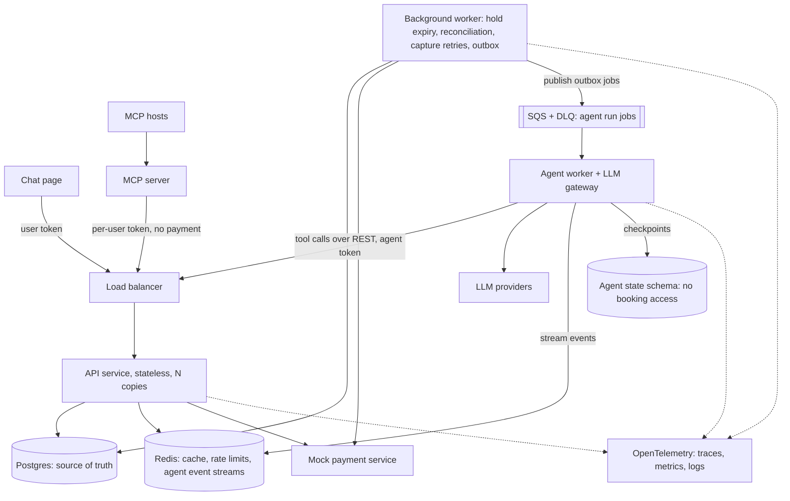

# Rushline: design doc

Status: draft v2 · Author: Chinmai S D · Last updated: 2026-11-26

## Context

Ticket launches for popular shows (and Tatkal-style train bookings) send thousands of users at a few hundred seats in the same minute. Most systems handle the read load badly (slow seat maps) or the write contention badly (double booking, stuck seats, double charges).

Rushline is a seat booking backend built to stay correct and fast under that rush, plus an AI agent that books seats on a user's behalf through the same backend. The agent is just another client, so every backend guarantee applies to it.

## Goals

- No double booking under any level of concurrency.
- Fast seat maps during a spike.
- No lost or double payments, even when the payment provider times out.
- An agent that can search, hold, book and cancel seats safely, with human approval before any payment.
- Fully reproducible AWS deployment with Terraform and keyless CI/CD.

## Non-goals

Real payments, refunds of captured money, signup flows (seeded users + JWT only), reviews, recommendations, dynamic pricing, multi-region, a polished frontend (one simple chat page).

## Requirements

### Functional

1. A user can browse shows and see a live seat map.
2. A user can hold up to 6 seats for 10 minutes.
3. A user can pay for a hold and get a booking.
4. A user can cancel a booking.
5. A user can chat with an agent that answers venue policy questions with citations and does 1 to 4 through tools. The agent may create holds on its own but must get explicit user approval before payment.

### Non-functional

| Requirement | Target |
|---|---|
| Double bookings | 0, always |
| Seat map latency | p99 < 200 ms |
| Hold and booking latency | p99 < 1 s during a spike |
| Confirmed bookings | never lost |
| Agent first token | < 2 s |
| Agent cost | hard token budget per conversation |
| Agent safety | never pays without approval, never touches another user's booking |
| Cloud cost | < $30/month, torn down when idle |

### Rough numbers (design scale)

| | Calculation | Result |
|---|---|---|
| Seat map reads | 1M users × 20 views/day | ~230 RPS avg, ~10k RPS at launch spike |
| Bookings | 200k/day | ~2/s avg, a few hundred/s at spike, on the same few hundred seats |
| Storage | 200k bookings × ~500 B | ~36 GB/year |
| Agent LLM calls | 5% of users × ~8 calls | ~400k/day, ~50 RPS peak |
| Agent tokens | 400k calls × ~3k tokens | ~1.2B tokens/day |

What the numbers decide:
- Reads are huge and repetitive → cache seat maps in Redis.
- Writes are small in volume but contend on the same rows → a correctness problem, solved with Postgres locking. No Kafka.
- 36 GB/year fits one Postgres instance → no sharding.
- LLM calls take seconds → run agent turns on background workers and stream results.
- Token volume dominates cost → an LLM gateway with model routing, fallback and per-user budgets.

Load tests will run at whatever scale the AWS budget allows. Reported numbers will always be measured, never extrapolated.

## Design

### Architecture



Editable version: [Eraser diagram](https://app.eraser.io/workspace/htfv8TE8hwly0ObFbIeZ), open only to members of its Eraser workspace.

Why each box exists:

| Box | Justification |
|---|---|
| Postgres | Bookings need transactions and row-level locking. Also holds policy chunks with pgvector, so RAG needs no extra database. |
| Redis | Seat-map reads are thousands of times more frequent than writes and must return in < 200 ms. Also rate limits and Redis Streams for agent events, so a reconnecting page can catch up. |
| Load balancer + N API copies | The API keeps no state in memory, so copies can be added during a spike and one crash doesn't take the system down. |
| SQS + agent worker | Agent turns take 10 to 30 s and must not tie up web workers. SQS gives retries and a dead-letter queue. |
| Agent state schema | Stores LangGraph checkpoints, so a run can stop while it waits for approval. It uses its own database role with no access to booking tables. |
| Background worker | Frees expired holds, reconciles unknown payment states, retries captures, and publishes outbox events to SQS, without slowing user requests. Shares booking code with the API and has its own database role. |
| Mock payment | Lets us inject latency, failures and timeouts on demand to prove the payment flow is safe. |
| MCP server | Exposes browse and hold tools to any MCP host. A thin wrapper over the REST API, so every rule still applies. |

Rules:
- The agent and MCP server call the REST API, never booking tables. Business rules live in the backend, never in prompts.
- The API never sends to SQS directly. It writes an outbox row in the same transaction as the run, and the background worker publishes it.
- The background worker is trusted backend code, so it uses the database directly. It imports the same booking modules as the API, so the rules exist in one place. The REST-only rule is for untrusted clients: the agent and MCP server.
- Redis never decides whether a seat is available. Holds and bookings always check Postgres inside their transaction.
- Tracing is added in phase 3, but request IDs and structured logs start in v0, so a request can be followed from the beginning.
- The LLM gateway is a module inside the worker, not a separate service, until a second consumer needs it.

Payment responsibilities:

| Component | Responsibility |
|---|---|
| API | Authorize, capture and void as part of the booking request |
| Background worker | Look up unknown payment results, retry captures, void abandoned authorizations |
| Payment provider | Runs the payment and reports its status |
| Agent worker | Asks to pay through the API, and never sees the payment token |

A timeout never means a payment failed. The payment may have succeeded and only the response was lost, so the result is looked up by key.

Database access:

| Component | Booking tables | Agent state |
|---|---|---|
| API | Read and write | None |
| Background worker | Limited role: holds, seats, bookings, outbox | None |
| Agent worker | None, uses the REST API | Read and write |
| MCP server | None, uses the REST API | None |

### API

Token checks live in one shared FastAPI dependency. Each route declares which actors it allows.

```
Auth: JWT bearer token (seeded demo users) with an actor claim:
  user   full access to the user's own data
  agent  short-lived, tied to one run_id, needs an approval to pay
  mcp    per user, can browse and manage holds, can't pay, cancel or decide approvals

POST   /auth/dev-token {email}                  local demos only (RUSHLINE_ENABLE_DEV_LOGIN)
GET    /auth/me                                 who the token belongs to, and the actor

GET    /health                                  liveness, no dependencies
GET    /ready                                   503 if Postgres is down, 200 "degraded" if only Redis is

GET    /shows?cursor=&limit=                    cursor pagination on (starts_at, id), limit 1 to 100
GET    /shows/{id}/seats                        cached ~1 s, X-Cache: hit|stale|miss|bypass | 404 unknown show
GET    /policies/search?venue_id=&q=            chunks with citations

POST   /holds      {show_id, seat_ids}          Idempotency-Key required
       201 {hold_id, show_id, seat_ids, expires_at}
       409 seat unavailable, or an open hold already exists for this show
       422 too many, duplicate or unknown seats | 429 limit
DELETE /holds/{id}                              204 | 404 not yours or unknown | 409 not active

GET    /holds/{id}                              status and seats, e.g. after a 202 booking

POST   /bookings   user:  {hold_id, payment_token}
                   agent: {hold_id, approval_id}   Idempotency-Key required
       201 {booking_id, hold_id, amount_paise, status: confirmed | pending_capture}
       202 {booking_id: null, status: processing}  authorize outcome unknown, worker settles it
       410 hold expired | 402 payment declined | 409 hold not active
       403 agent without a valid approval, or mcp token (agents: phase 2)
GET    /bookings                                the caller's bookings
DELETE /bookings/{id}                           204 (soft cancel) | 409 while pending_capture

Any route: 429 rate limited (Retry-After) | 503 pool exhausted or Postgres down (Retry-After)

POST   /conversations                           201 {conversation_id}
POST   /conversations/{id}/messages {text}      202 {run_id}   (run + outbox row in one transaction)
GET    /runs/{id}                               status, output, tokens, cost (user, or its own agent)
PATCH  /runs/{id} {status, output, usage}       agent token for this run only
GET    /runs/{id}/stream                        SSE, Last-Event-ID replays missed events; ends at done,
                                                failed or waiting for approval
POST   /approvals {hold_id}                     agent only: one hold, amount and expiry from the hold
GET    /runs/{id}/approvals                     the user's approvals for the run
POST   /runs/{id}/approvals/{aid} {decision, payment_token}
                                                user token only, resumes the run
GET    /chat                                    the simple chat page
```

GETs and DELETEs are safe to retry by nature. POSTs are safe to retry only because of the Idempotency-Key. Agent tools build the key from `run_id` and the step number, so a redelivered SQS message repeats the same request instead of making a new one.

### Data model

```
users, venues, shows
seats            id, show_id, seat_no, price_paise, status, hold_id, version
                 UNIQUE (show_id, seat_no), INDEX (show_id, status)
                 partial INDEX (hold_id) WHERE hold_id IS NOT NULL
                 CHECK: status = 'available' exactly when hold_id IS NULL
holds            id, user_id, show_id, status, expires_at, payment_deadline
                 partial INDEX (expires_at) WHERE status IN ('active', 'paying')
                 partial UNIQUE (user_id, show_id) WHERE status IN ('active', 'paying')
bookings         id, user_id, hold_id UNIQUE, amount_paise, status, payment_ref, created_at
                 partial INDEX (created_at) WHERE status = 'pending_capture'
idempotency_keys (user_id, key) PK, request_hash, response_status, response_body, created_at
                 response NULL means the request is still in progress
outbox           id, event_type, payload, created_at, published_at
                 partial INDEX (id) WHERE published_at IS NULL

conversations    id, user_id, created_at
agent_runs       id, conversation_id, status, tokens_in, tokens_out, cost_usd
approvals        id, run_id, hold_id, amount_paise, status, expires_at, used_at, payment_token
policy_chunks    id, venue_id, text, embedding (pgvector), tsv (full-text)

Separate schema and role, no booking access:
agent state      LangGraph checkpoints
```

- Money is stored as integer paise, never floats.
- `bookings.hold_id UNIQUE` is a database-level guarantee that one hold produces at most one booking.
- The partial unique index on `holds` is a database-level guarantee of one open hold per user per show, even when two requests arrive together. A converted, expired or released hold no longer counts.
- Seat `status` is stored on the row so a single conditional UPDATE can claim it.

### Hold lifecycle

```
active ──> paying ──> converted
  │          │
  │          └──> released   (payment failed, voided, or deadline passed)
  └──> expired | released
```

The expiry worker only touches `active` holds. A hold in `paying` is protected until its payment deadline.

### Booking lifecycle

```
pending_capture ──> confirmed ──> cancelled
       │
       └──> capture_failed   (retries exhausted, raises an alert)
```

A booking is created as `pending_capture` and only becomes `confirmed` after capture succeeds. This way, a crash between saving and capturing leaves a row the worker can find.

## Deep dives

### 1. Concurrency on holds

A naive read-then-write lets two users hold the same seat under READ COMMITTED. We will reproduce this, then implement and benchmark:

1. Pessimistic: `SELECT ... ORDER BY id FOR UPDATE` (and a `NOWAIT` variant). Ordered locking prevents deadlocks.
2. Optimistic: `version` column, `UPDATE ... WHERE version = :v`, retry on zero rows.
3. Atomic conditional update: `UPDATE ... WHERE id = ANY(:ids) AND status = 'available' RETURNING id`, all or nothing.
4. Optional: naive code under SERIALIZABLE isolation with retries.

Reproduced in v0. Measured on the dev machine: 20 different users requesting the same 2 seats at once with the naive strategy got 3 to 11 successful holds per run (median 7, 20 runs), while each seat row can point at only one hold. On CI's faster machine the same race didn't happen by itself, because it depends on timing. So `tests/test_race.py` pauses every racer between its read and its write (the worst interleaving naive allows) and asserts that all 10 racers "win". A correct strategy must survive that same pause.

Benchmark: 500 concurrent clients, each a different user, 50 seats, 2 adjacent seats per request. Different users matter because the one-open-hold index would otherwise reject requests before they compete for seats. Measured: double holds (must be 0), requests/s, holds/s, p50/p99 latency, 409 rate, retries, deadlocks.

Result (ADR 002, [`docs/benchmarks/holds-v1.md`](benchmarks/holds-v1.md)): naive double-held 200 seats across 5 trials, and every safe strategy held 0. **Pessimistic (ordered `FOR UPDATE`) is the default.** It had the best safe p50 with no retries, and it can't deadlock against other claims because locks are taken in id order. Every strategy retries deadlock victims, and `POST /holds` requires an `Idempotency-Key`.

### 2. Payment vs hold expiry

Prevention: payment starts with `UPDATE holds SET status = 'paying' WHERE id = :id AND status = 'active' AND expires_at > now()`. Zero rows means 410 and no charge.

Recovery for the cases prevention can't cover (provider timeouts leave the result unknown): authorize, then capture.

1. Flip hold to `paying`.
2. Authorize with the provider, passing our idempotency key.
3. One transaction: create booking as `pending_capture`, mark seats `booked`, hold `converted`.
4. Capture, then mark the booking `confirmed`. If step 3 failed, void instead.
5. If authorize timed out, the reconciliation worker looks the payment up by key and either completes the booking or voids it. Holds in `paying` past their deadline are always resolved this way.
6. If capture didn't finish, the worker retries it with the same key for any booking stuck in `pending_capture`. If retries run out, the booking becomes `capture_failed` and raises an alert.

Measured in v2 ([`docs/benchmarks/payments-v2.md`](benchmarks/payments-v2.md)): with 10% and 30% of every provider call timing out, nothing was lost, nothing was charged twice and no hold was left `paying`.

### 3. Agent safety

Full reasoning in ADR 004.

- The agent uses a short-lived token with `actor=agent` and its `run_id`, so it can only act as that user and the API can tell it apart from the user.
- Hold limits, rate limits and idempotency are enforced by the backend.
- Agent payments need an approval tied to one hold and amount, single use, expiring no later than the hold.
- Only a `user` token can decide an approval. Agent and MCP tokens are rejected, so the agent can't approve itself.
- The user gives the payment token to the API at approval time. It's cleared once used or expired, and is never returned by an API or sent to the agent or LLM.
- MCP hosts get a per-user token that can browse and manage holds. Payment happens only in the chat page or direct API.
- Retrieved policy text is treated as data, never instructions. A red-team suite tests injection attempts.

### 4. Background work and agent runs

- **Queuing a run:** the API saves the run and an outbox row in one transaction, and the worker publishes it to SQS. A crash can't leave a saved run that never gets queued. Resuming after approval works the same way. This adds a polling delay, which we'll measure against the first token target.
- **Waiting for approval:** the run saves a checkpoint and stops, so no worker sits idle.
- **Duplicates:** SQS can deliver a message twice. Checkpoints and idempotency keys make a repeat safe.
- **Long runs and crashes:** the worker keeps extending the SQS visibility timeout during a run, so a job isn't redelivered while it's still running. If the worker crashes, the timeout lapses and SQS retries it. After repeated failures, the job goes to the DLQ, and a documented redrive process puts it back once fixed.
- **Several worker copies:** workers claim rows with `FOR UPDATE SKIP LOCKED`, so two copies don't process the same hold or booking.
- **Reconnecting:** agent events go to Redis Streams with an ID, so the page can replay what it missed.

## Alternatives considered

| Option | Rejected because |
|---|---|
| Book directly without holds | Either holds a lock during a slow payment call or charges users for seats they don't get. See ADR 001. |
| Separate vector database | RAG corpus is small. pgvector avoids running and paying for another system. |
| Kafka for events | Write volume is a few hundred/s at peak. SQS plus an outbox table is enough. |
| WebSockets for streaming | Communication is one-way. SSE is plain HTTP and works through the ALB with no extra setup. |
| LLM gateway as its own service | Only one consumer today. Adds a network hop and a deployment for no benefit yet. |
| Capture before saving the booking | If the save then fails, money has moved for a seat the user didn't get, and a refund is needed. See ADR 003. |
| Payment webhook | Webhooks can be lost, so the lookup is still needed. Adds a public endpoint for a mock provider. Worth adding only with a real provider. |
| Agent uses the user's own token | The API couldn't tell agent from user, so it couldn't require approval only for the agent. See ADR 004. |
| Shared MCP service account | The API couldn't tell whose booking it was touching. |
| Redis pub/sub for agent events | Events are lost if the browser is disconnected when they're sent. |
| Worker calls an internal API for booking changes | `SKIP LOCKED` row locks wouldn't cover work done over HTTP, cleanup would depend on the API during a rush, and it adds endpoints with no new guarantee. Shared code and a limited role solve the actual risk. |
| API publishes directly to SQS | A crash between the database commit and the send loses the job. The outbox avoids that, and the background worker is its publisher. |
| Invalidate the seat map cache on every write | Staleness of about 1 s is accepted, since holds check Postgres. Clearing a hot key on every write could cause a stampede in a rush. To be measured in v3. |

## Risks

| Failure | What happens |
|---|---|
| Postgres down | Holds and bookings fail with 503 and `Retry-After`. Seat maps serve stale cache briefly. No data loss (RDS backups). |
| Pool exhausted under a spike | Requests that wait longer than the pool timeout get 503 with `Retry-After: 1`, not 500. Found by the payment reliability check. |
| Redis down | Seat maps fall back to Postgres (slower). Rate limits fail open with a stricter per-instance limit. Live agent events stop until it returns. |
| Payment provider slow | Timeouts bound the wait. Holds stay `paying` and reconciliation resolves them. |
| Crash before capture | Booking stays `pending_capture` and the worker retries. If the authorization has expired, it becomes `capture_failed` and raises an alert. |
| LLM provider down | Gateway falls back to a second model. If all fail, the run fails cleanly and the user is told. |
| Prompt injection | Agent can't exceed the user's own permissions, and it can't pay or approve its own payment without the user. |
| Cost overrun | AWS budget alarm, no NAT gateway, `terraform destroy` when idle, per-user token budgets. |

## Open questions

Both earlier questions are resolved (phase 2):

- **The agent worker's token:** the worker mints a 15-minute run-scoped token itself, since it holds the signing key. Jobs carry ids, never bearer tokens (ADR 004).
- **Reporting usage:** the worker reports status, output and token usage through `PATCH /runs/{id}` with its run token. Usage is added, not replaced.

## Rollout and how we'll know it works

| Milestone | Proof |
|---|---|
| Backend core | Race reproduced, then 0 double holds across all strategies; benchmark table published |
| Reliability | Payment timeout injection at 10%: 0 lost payments, 0 double charges after reconciliation. Crash injected between booking save and capture: booking still ends `confirmed` |
| Scale | Load test report: p99 latency and throughput at a stated request rate. Done in v3 ([`docs/benchmarks/load-v3.md`](benchmarks/load-v3.md)): seat map p99 22.7 ms at 600 rps of launch-spike traffic with 0 errors, against 8.2 s and 29% errors without the cache |
| Agent | Scenario eval pass rate in CI; red-team suite with 0 unsafe actions; agent and MCP tokens rejected when paying without approval or deciding approvals. Done in phase 2: 4 scripted scenarios pass in CI, and 7 red-team attacks end with 0 unsafe actions. Live evals against OpenAI need a key and haven't been run |
| Cloud | `terraform apply` from scratch to working system; deploys via GitHub Actions with OIDC |
| Ops | Traces from agent to API to DB; SLO dashboard; one written postmortem |
